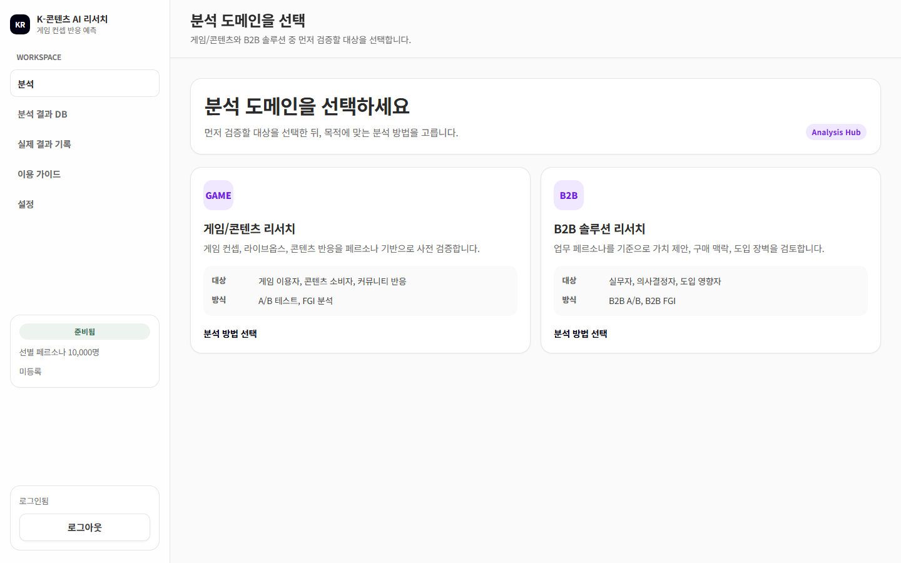
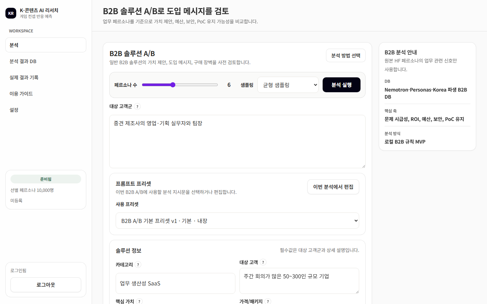
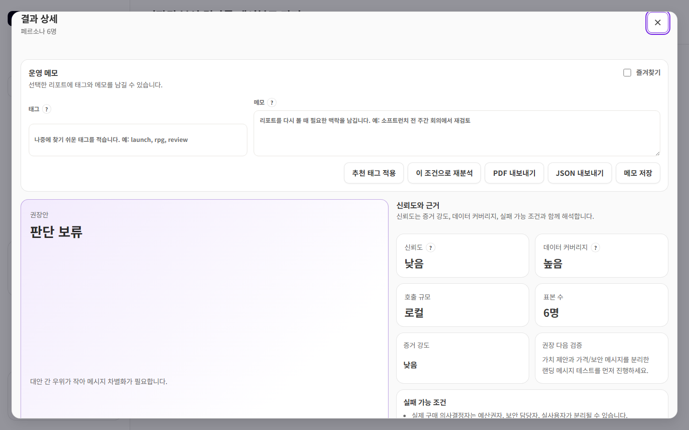
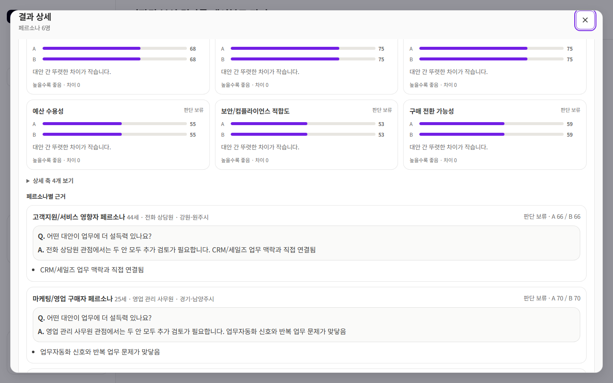

# K-콘텐츠 AI 리서치

**가상 페르소나 패널과 LLM으로 콘텐츠·게임 기획안과 B2B 솔루션 아이디어를 실제 조사 전에 검증하는 리서치 도구**

> 이 저장소는 프로젝트 소개용입니다. 소스 코드, 분석 로직, 프롬프트는 공개하지 않습니다.

## 해결하려는 문제

1. 기획안에 대한 반응을 확인하려면 실제 사용자 조사가 필요한데, 조사는 느리고 비쌉니다.
2. 기획 단계에서 여러 대안을 비교할 근거가 없어 감으로 고르게 됩니다.
3. 예측과 실제 결과를 비교해 두지 않아 다음 기획에 학습이 쌓이지 않습니다.

K-콘텐츠 AI 리서치는 한국인 인구 통계를 반영한 합성 페르소나 1만 명 중에서 분석 목적에 맞는 패널을
뽑고, 그 패널의 관점으로 기획안을 비교·인터뷰해 **실제 조사 전에 걸러낼 것과 확인할 것**을 알려 줍니다.

## 주요 기능

| 기능 | 설명 |
| --- | --- |
| 게임/콘텐츠 A/B 테스트 | 컨셉과 비교 대안을 입력하면 축별 점수, 권장안, 페르소나별 근거를 생성 |
| 게임/콘텐츠 FGI | 샘플링한 페르소나 패널로 가상 포커스 그룹 인터뷰 리포트를 만들고 후속 질문을 이어감 |
| B2B 솔루션 A/B | 업무 페르소나로 가치 제안·예산·보안·PoC 유지 가능성을 비교 |
| B2B FGI | 구매 맥락, 도입 장벽, 내부 설득 조건, PoC 검증 포인트를 가상 인터뷰로 분석 |
| 분석 결과 DB | 결과 저장·검색·필터·비교·삭제, PDF·JSON 내보내기 |
| 예측 vs 실측 | 예측 이후 실제 KPI와 정성 결과를 기록해 적중률을 확인 |
| 멀티 LLM | OpenAI, Claude, Gemini 중 선택해 사용 |

## 화면

**B2B 솔루션 A/B 입력**: 대상 고객, 솔루션 정보, 비교할 메시지 대안을 입력합니다.

**결과 상세**: 권장안과 함께 신뢰도, 데이터 커버리지, 증거 강도, 실패 가능 조건을 보여 줍니다.
대안 간 차이가 작으면 억지로 승자를 고르지 않고 **판단 보류**와 다음 검증 방법을 제시합니다.

**축별 비교와 페르소나별 근거**: 점수만이 아니라 어떤 직무·연령의 페르소나가 왜 그렇게 판단했는지 남깁니다.

> 화면의 입력값은 시연용 가상 예시이고, 페르소나는 모두 합성 데이터입니다.

## 설계 원칙

- **과신하지 않는 결과**: 모든 결과에 신뢰도, 표본 커버리지, 실패 가능 조건을 함께 표시합니다.
  표본이 적은 집단의 반응은 개인차와 구분되지 않는다고 명시합니다.
- **실측으로 닫는 루프**: 예측을 저장해 두고 실제 결과를 기록해, 도구의 적중률을 스스로 확인할 수 있게 합니다.
- **키와 데이터는 사용자 쪽에**: 로컬 실행이 기본이며, API 키는 분석 결과 DB나 프롬프트 파일에 저장하지 않습니다.
- **가벼운 런타임**: 서버는 파이썬 표준 라이브러리만으로 동작하고, 화면은 빌드 과정 없는 HTML·CSS·JS입니다.

## 구성

| 영역 | 내용 |
| --- | --- |
| 실행 형태 | 로컬 HTTP 서버 + 브라우저 화면, Windows 설치형 EXE |
| 실행 모드 | 혼자 쓰는 로컬 모드, 계정 기반 인증 모드(운영자가 계정 발급, 공개 가입 없음) |
| 데이터 | 합성 페르소나 DB(게임/콘텐츠용 1만 명, B2B 업무 페르소나), SQLite 결과 저장소 |
| LLM | OpenAI · Anthropic Claude · Google Gemini |

## 품질 관리

- 단위·통합 테스트 1,000개 이상, 실제 브라우저로 화면 흐름을 확인하는 스모크 테스트
- 고정된 기준 사례로 분석 결과를 회귀 검사하는 평가 하네스
- Windows·Ubuntu에서 도는 CI, 변경마다 독립 리뷰

## 데이터 출처

페르소나 DB는 NVIDIA의 [`nvidia/Nemotron-Personas-Korea`](https://huggingface.co/datasets/nvidia/Nemotron-Personas-Korea)
(CC BY 4.0)를 가공해 만들었습니다. 원본은 실제 개인 정보가 아닌 합성 데이터입니다.

## 저작권

© 2026 JongIn Lee. All rights reserved.

이 저장소의 문서와 이미지는 저작권자의 허락 없이 복제, 수정, 배포, 상업적으로 이용할 수 없습니다.
